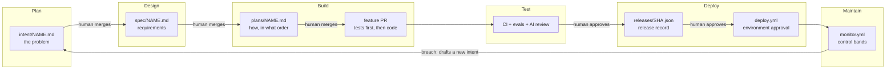
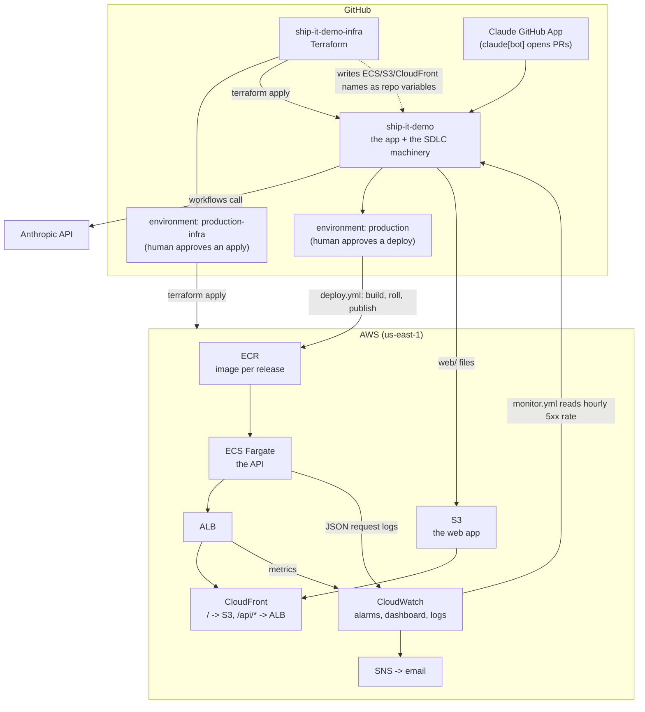
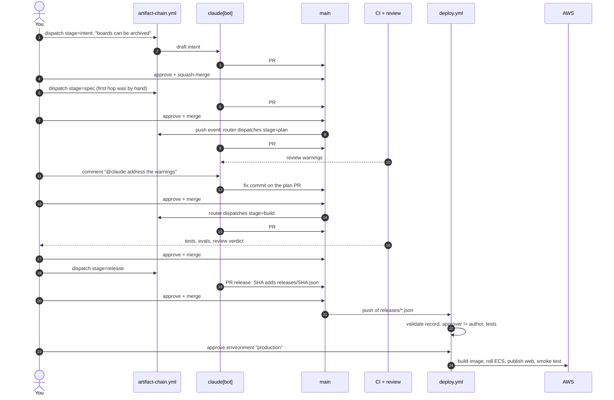
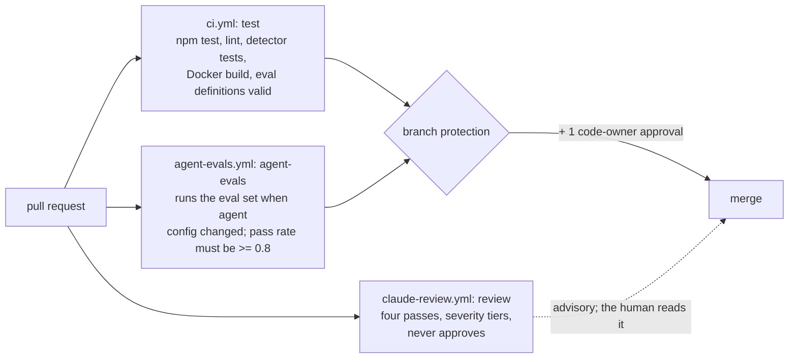
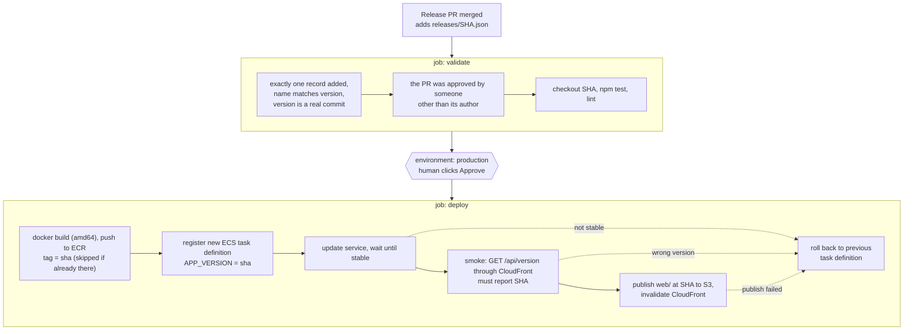
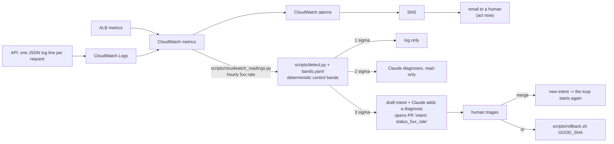
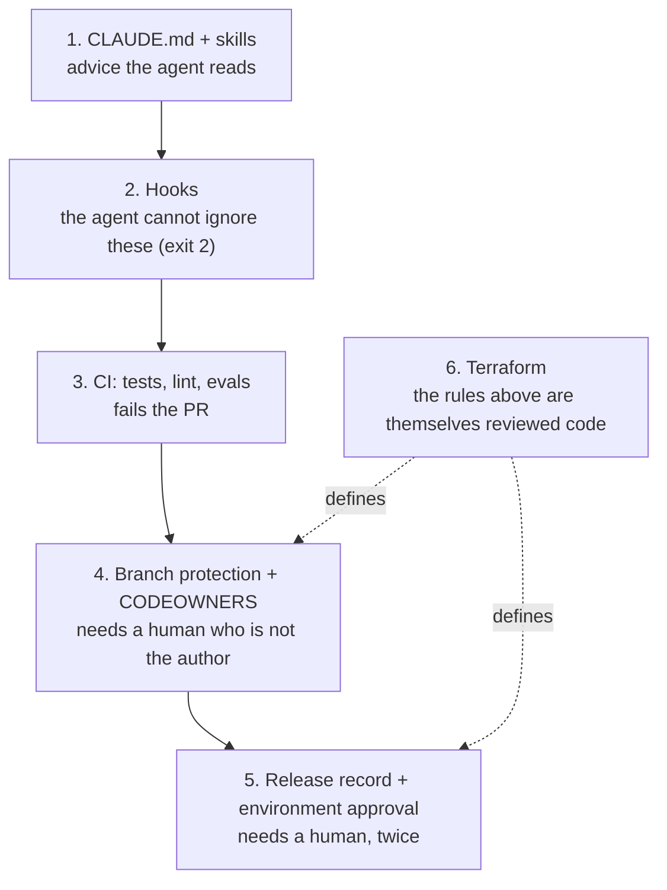

# How this demo works, step by step

This guide explains how each stage of the [AI-native SDLC playbook](https://claude.com/blog/the-ai-native-sdlc-playbook) is implemented here, and how the pieces connect. Read it top to bottom once; use the tables as a reference afterwards.

**Contents**
1. [The idea in one picture](#1-the-idea-in-one-picture)
2. [The systems and repos](#2-the-systems-and-repos)
3. [Who may do what](#3-who-may-do-what)
4. [Walkthrough: one feature, start to finish](#4-walkthrough-one-feature-start-to-finish)
5. [Stage by stage: what implements what](#5-stage-by-stage-what-implements-what)
6. [The deploy, in detail](#6-the-deploy-in-detail)
7. [The Maintain loop](#7-the-maintain-loop)
8. [Governance as code: the layers](#8-governance-as-code-the-layers)
9. [What went wrong while building it](#9-what-went-wrong-while-building-it)
10. [Replaying it](#10-replaying-it)

---

## 1. The idea in one picture

Each stage writes a **file in git**. The next stage's agent reads that file. A **human approves** between stages, and the agent that wrote something is never the one that approves it.

Every arrow labelled "human" is a pull request that **you** approve and merge. Everything else is automatic.

---

## 2. The systems and repos

| Repo | Holds | Changes how |
|---|---|---|
| [`ship-it-demo`](https://github.com/sergeyyegournov/ship-it-demo) | The app (`src/`, `web/`), the SDLC artifacts (`intent/ spec/ plans/ releases/`), the agent config (`CLAUDE.md`, `.claude/`), the evals, the workflows | Pull requests. `main` is protected. |
| [`ship-it-demo-infra`](https://github.com/sergeyyegournov/ship-it-demo-infra) | Terraform: the app repo's branch protection and environments (`github/`), the whole AWS stack (`aws/`) | Pull requests. `terraform plan` runs on the PR; `apply` runs after merge and waits for a human. |

Terraform owns the controls, so changing the rules themselves is a reviewed, diffable PR rather than a click in a settings page.

---

## 3. Who may do what

This table is the heart of the design. If you remember one thing, remember this.

| Actor | Can | Cannot |
|---|---|---|
| **claude[bot]** (the Claude app, via `artifact-chain.yml`) | Open PRs: intent, spec, plan, feature, release record | Approve or merge anything. Edit `.github/`, `.claude/hooks/`, `releases/` or `CODEOWNERS` from an interactive session (hooks block it). Deploy production. |
| **Claude review job** (`claude-review.yml`) | Comment on PRs with findings and a verdict. Push a fix commit when someone comments `@claude`. | Approve or request changes. It is told never to. |
| **GitHub Actions token** | Read the repo; write only where a job asks for it | Approve pull requests (disabled in repo settings) |
| **You (code owner)** | Approve and merge PRs. Approve a `production` deployment. | Approve your *own* PR. GitHub blocks it, which is why the bot authors the PRs. |

Two independent human gates guard production:
1. A **release record** (`releases/<sha>.json`) must be merged through a PR approved by someone other than its author. `deploy.yml` checks this.
2. The **`production` environment** requires an explicit approval click before the deploy job runs.

---

## 4. Walkthrough: one feature, start to finish

The feature is *archive a board*. These are the real PRs from this repo.

| Step | Artifact | PR | What the human decides |
|---|---|---|---|
| Plan | `intent/archive-board.md` | #3 | Is this the right problem? |
| Design | `spec/archive-board.md` (15 requirements, 8 flagged concerns) | #4 | Are the requirements and the open questions right? |
| Build (plan) | `plans/archive-board.md` | #5 | Is the approach sound? This is the "plan mode" checkpoint, before any code exists. |
| Build (code) | `src/app.js`, `test/archive.test.js` | #6 | Does the diff match the plan? Did review find blockers? |
| Deploy | `releases/<sha>.json` | one per release | Release this exact commit? |
| Deploy | environment approval | in the Actions run | Ship it now? |

How the chain advances: pushing a merged intent, spec or plan to `main` makes the **route** job in `artifact-chain.yml` dispatch the next stage. (A bot cannot trigger a workflow with its own push, and `claude-code-action` rejects `push` events, so the router dispatches a `workflow_dispatch` run, which the action accepts.)

---

## 5. Stage by stage: what implements what

### Plan: capture intent
- `intent/<name>.md` holds the problem, who has it, and what done looks like.
- Created by `artifact-chain.yml` (`stage=intent`, input `intent_request`), or drafted automatically from telemetry (section 7).
- Why a file: the next agent reads it, so intent survives across sessions and people.

### Design: requirements
- `spec/<name>.md`: numbered requirements (R1...), a design, and a list of concerns with defaults. A concern is a question the agent could not settle alone; you answer it by accepting or changing the default.
- `.claude/skills/security-policy/SKILL.md` is a skill the agent loads when it touches input handling, so security rules apply without being repeated in every prompt.

### Build: plan, then code
- `plans/<name>.md`: files to change, commit order (**failing tests first**), risks, and a proof table of commands with expected results.
- `CLAUDE.md` is the short repo guide the agent reads at the start: layout, conventions, the **"Verifying your work"** block (`npm test && npm run lint`), and the protected paths.
- `.claude/agents/verifier.md` is a subagent that checks a change against the plan.
- **Hooks** (`.claude/settings.json`) enforce rules the agent cannot talk its way around. A hook that exits 2 blocks the action and sends its message to the agent:

| Hook | Fires on | Does |
|---|---|---|
| `protect-paths.sh` | Edit/Write | Blocks edits to `.github/`, `.claude/hooks/`, `releases/`, `CODEOWNERS` |
| `lint-after-edit.sh` | Edit/Write (after) | Runs the linter and feeds failures back |
| `no-test-edits.sh` | Edit/Write | In fix tasks (`CLAUDE_TASK=fix`), blocks editing existing tests |
| `release-gate.sh` | Bash | Denies `scripts/deploy.sh production <sha>` unless `releases/<sha>.json` exists on `origin/main` |

### Test: three checks on every PR

- **Feedback loop:** the agent runs the "Verifying your work" commands itself before saying it is done; CI repeats them.
- **Evals** (`evals/*.json`): each case gives the agent a task at a pinned commit, lets it work in a throwaway worktree with the *proposed* `CLAUDE.md`/`.claude/` overlaid, then runs deterministic checks (`evals/checks/*.js`). It only runs when agent config changes, because it spends API credits. A bad `CLAUDE.md` that drops the pass rate below 0.8 blocks the merge. This is how you test your *instructions*, not just your code.
- **Review** follows `REVIEW.md`: correctness, security, tests, scope; severity tiers (blocker, warning, nit), a nit cap, and a rule that it never approves. `track_progress: true` makes the action post a real comment.
- `required checks` are `test` and `agent-evals`. `review` is advisory.

### Deploy: see section 6.

### Maintain: see section 7.

---

## 6. The deploy, in detail

- **Where the release record comes from:** `stage=release` runs `scripts/make_release_record.sh`, which writes `version`, `requested_by`, `requested_at`, the commits since the last release, the rollback runbook, and **evidence** (the PR's test and eval check results) read from GitHub, then opens a PR with only that file.
- **Why a file in git:** it is the "change ticket". It records what was released, with evidence, and its review history shows who approved it.
- **Rollback** (`scripts/rollback.sh <good-sha>`) refuses unless `<good-sha>` has a release record on `main`. It reuses the image already in ECR (nothing is rebuilt), so it takes about as long as a deploy without the build.
- **Private repo?** Required reviewers on environments need a public repo or GitHub Enterprise. `docs/ALTERNATIVE-RELEASE-GATE.md` shows the release-record-only variant.

---

## 7. The Maintain loop

Two layers on purpose:
- **Alerting** (CloudWatch alarms -> email) tells a person *now* that something is broken.
- **Detection for the loop** (`monitor.yml`) asks a slower question: *did a release move a metric outside its normal band?* The bands are plain Python with no model involved, so the same data always gives the same answer. Only after a breach does Claude act, and only within that tier's permission (log, diagnose read-only, or propose a PR). It never deploys and never rolls back.

`monitor.yml` details: opt-in on a schedule (repo variable `MONITOR_ENABLED=true`), always runnable by hand (`scenario=live|none|spike|drift`; `live` reads CloudWatch, the others are synthetic), deduplicated against an already-open `intent/status_5xx_rate-*` PR. More in [`MONITORING.md`](MONITORING.md).

---

## 8. Governance as code: the layers

Each layer catches what the one before it cannot.

| Layer | Where | Stops |
|---|---|---|
| Guidance | `CLAUDE.md`, `.claude/skills/` | Honest mistakes |
| Hooks | `.claude/hooks/`, `.claude/settings.json` | The agent editing protected paths, editing tests to make them pass, deploying production from a session |
| CI | `ci.yml`, `agent-evals.yml` | Broken code, broken instructions |
| Review | `claude-review.yml`, `REVIEW.md` | Problems a human would miss reading a long diff |
| Protection | Terraform `github/`, `.github/CODEOWNERS` | Merging without checks or approval; self-approval |
| Release | `releases/`, `deploy.yml`, `production` environment | Shipping without a recorded, approved decision |

---

## 9. What went wrong while building it

Honest notes, because each one is a real constraint someone replaying this will hit.

| Symptom | Cause | Fix |
|---|---|---|
| Bot PRs got no review | `claude-code-action` ignores bot-authored PRs unless allowed | `allowed_bots: 'claude[bot]'` |
| Review ran but posted nothing | Agent mode with a read-only tool list | `track_progress: true` |
| Chain stopped after a merge | The action rejects `push` events | A router job dispatches `workflow_dispatch` runs |
| Eval gate passed when it should fail | `| tee` hid the exit code | `shell: bash` (pipefail) |
| Environment reviewers rejected on a private repo | Needs Enterprise | Repo made public; alternative documented |
| Deploy failed at checkout (twice) | `actions/checkout` cannot resolve a *short* SHA via `ref` | `git checkout "$VERSION"` in a step |
| Deploy failed: "Region is missing" | `amazon-ecr-login` reads `AWS_REGION`, the CLI reads `AWS_DEFAULT_REGION` | Set both |
| ALB creation failed | Default VPC has two subnets in one AZ | Filter `default-for-az` |
| Terraform plan wanted to *create* the protection rule | Lifting and restoring protection changes its ID | Re-adopt it under a new address |
| Review check red on the release PR | Hit `--max-turns` | Raised the limit |

Two recurring facts:
- **Workflow files are protected.** Any change under `.github/` has to land through a deliberate, human-run "lift protection, merge, restore protection" step. The bot cannot do it, and that is the point.
- **Nothing here is zero-cost.** Evals spend API credits (so they only run when agent config changes), and AWS runs roughly $30-40 a month while up. `terraform destroy` for the AWS stack is a manual workflow dispatch in the infra repo.

---

## 10. Replaying it

- A timed, scripted run with talking points: [`RUNBOOK.md`](RUNBOOK.md).
- Browse the finished run: `gh pr list --state merged`, and read `intent/ spec/ plans/ releases/`.
- File-by-file map of the playbook's plays: the table in the [`README`](../README.md).
- Monitoring in detail: [`MONITORING.md`](MONITORING.md).
- Rollback procedure: [`../runbooks/rollback.md`](../runbooks/rollback.md).
